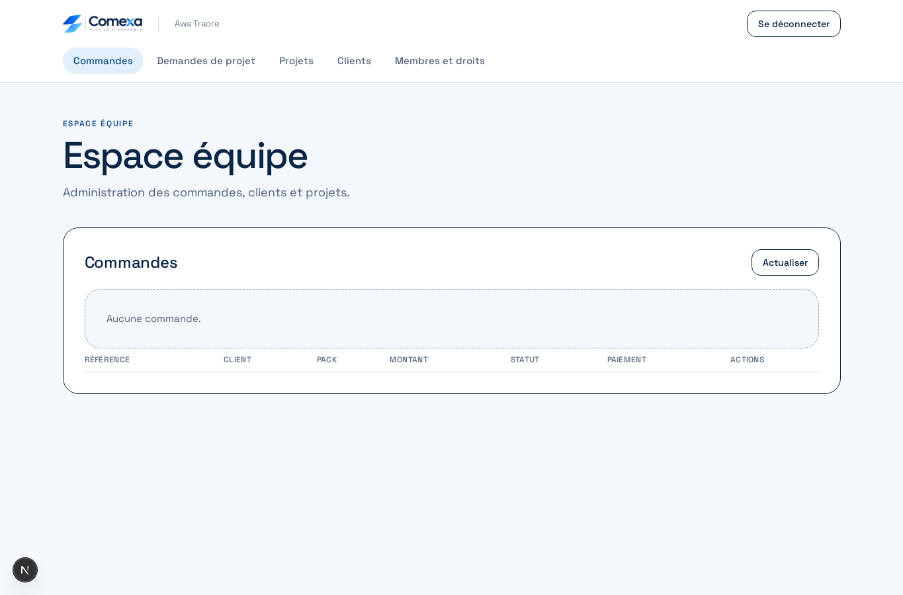
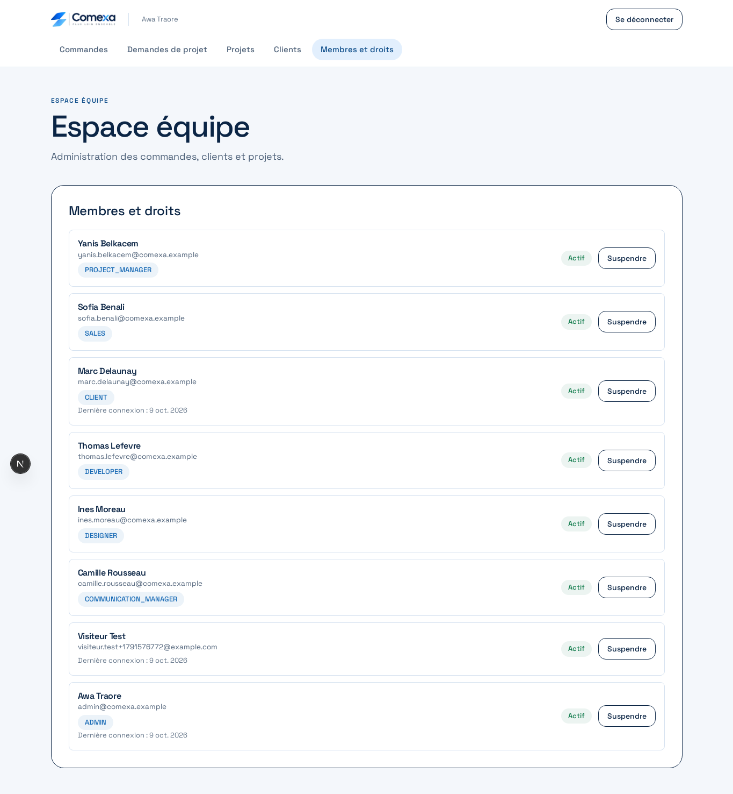
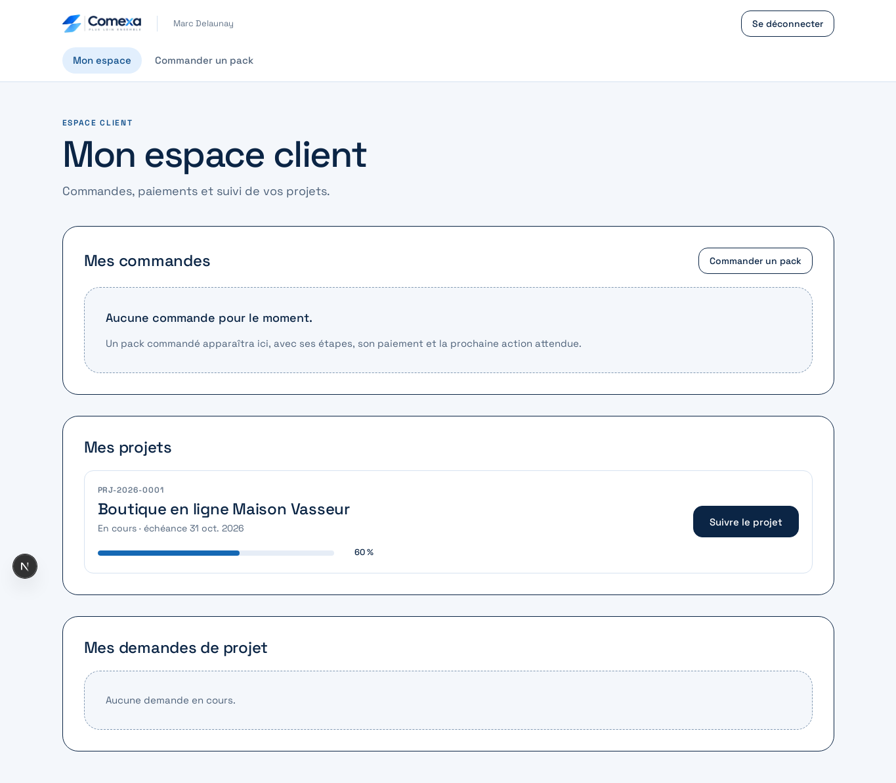
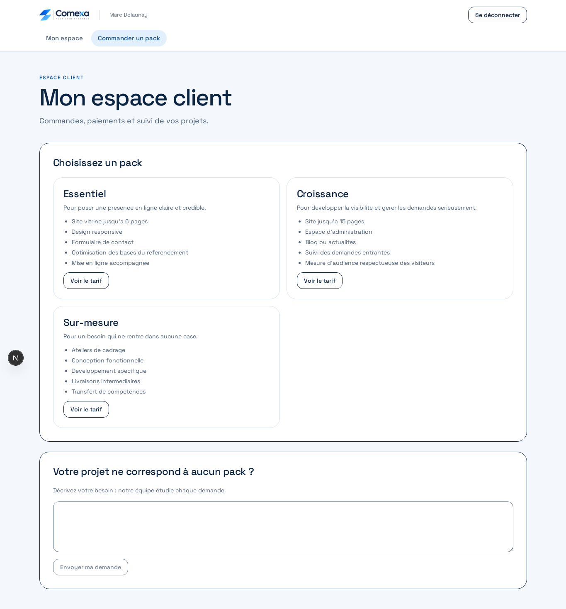
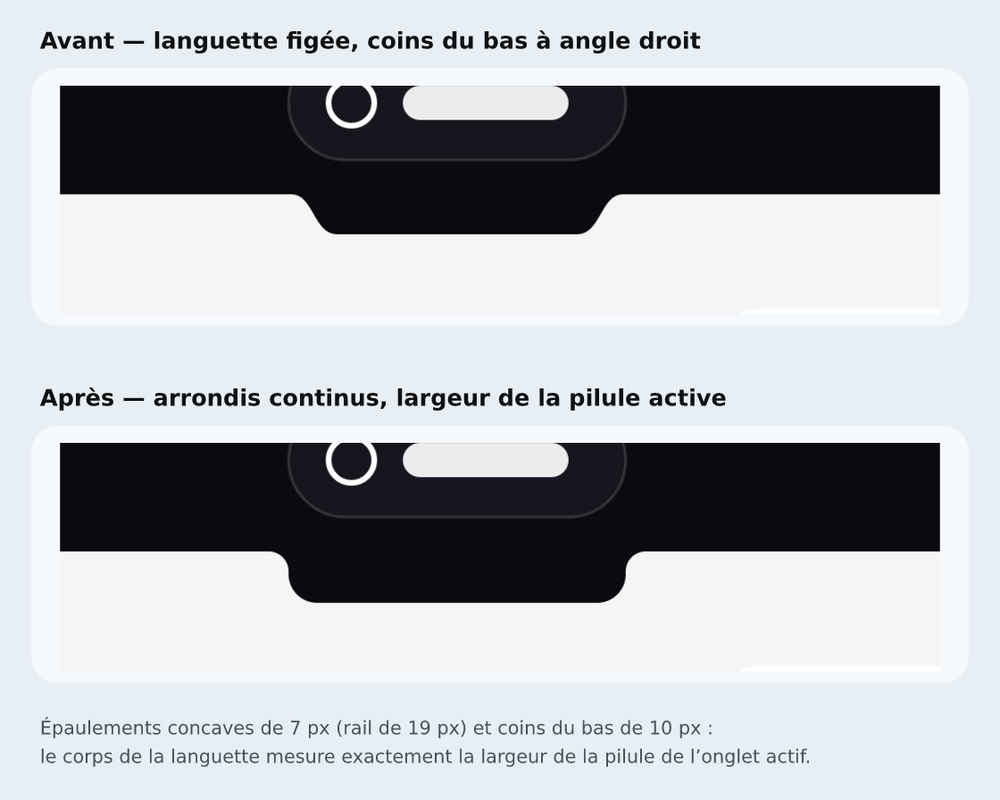

# Captures des espaces

## Espace équipe : Commandes

## Espace équipe : Membres et droits

## Espace client : Mon espace

## Espace client : Commander un pack

## Coque : languette de l'onglet actif

Avant / après — la languette n'est plus figée : ses congés concaves et ses coins
du bas arrondis sont calculés sur la largeur de la pilule active
(`src/lib/notch.mjs`).

